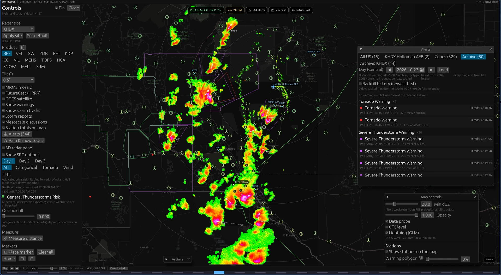
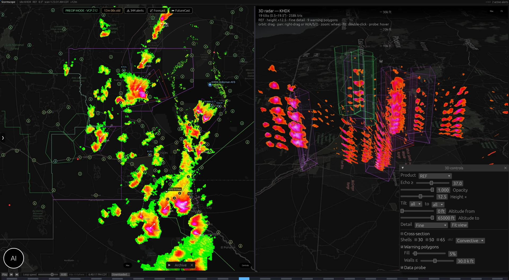
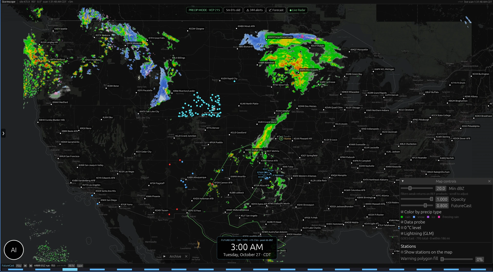

# Stormscope

**Fast native NEXRAD weather radar for Linux, Windows and Android.** Live Level II radar, rotatable 3D storm volumes, NWS warnings, storm tracks, weather stations, and optional AI forecasting.

[](https://github.com/photon01666/stormscope/releases/latest)


[](https://github.com/photon01666/stormscope/actions/workflows/ci.yml)
[](LICENSE)



*Live radar with NWS warnings, storm tracks and weather-station observations.*

**No Stormscope account and no telemetry.** The core radar, warnings and forecasts work without keys. Optional AI and weather-station layers use your own provider keys, stored locally.

## Download

**[Download the latest release →](https://github.com/photon01666/stormscope/releases/latest)**

| Platform | Release file | Requirements |
| --- | --- | --- |
| **Linux** | `stormscope-<version>-linux-x86_64.AppImage` | x86_64, Vulkan, Wayland or X11, WebKitGTK 4.1 |
| **Windows** | `stormscope-<version>-windows-x86_64-setup.exe` | Windows 10/11, x86_64, DX12, WebView2 runtime |
| **Android** | `stormscope-<version>-android.apk` | Android 8+, arm64-v8a, YouTube app for video playback |

**Coverage:** the radar network is US NEXRAD — CONUS, Alaska, Hawaii, Guam and Puerto Rico. The basemap is worldwide. There is no macOS or iOS build.

> **Forecast videos:** desktop uses the platform WebView for in-app playback (WebKitGTK on Linux, WebView2 on Windows). On Android, YouTube's embedded player is blocked by its sign-in/bot check, so playback opens the installed YouTube app (or the browser if YouTube is absent).

Release builds check GitHub for updates. Keep the Linux AppImage in a writable folder so it can replace itself. Android asks for install permission once; after that it can update itself from GitHub Releases.

> **Windows:** the installer is not code-signed. If SmartScreen appears, choose **More info → Run anyway**.

## What it does

- **Live and archive radar** — NEXRAD Level II, every standard moment, derived products, timeline playback and a 3D volume view.
- **Storm awareness** — NWS warnings, SPC outlooks, local storm reports, mesoscale discussions, storm tracks with arrival ETAs, MRMS and GOES satellite.
- **Weather stations** — Synoptic network observations, free METAR airport reports, and your own Ambient Weather station, shown as temperature badges with readable popups.
- **Forecasting** — 18- or 48-hour HRRR FutureCast with precipitation-type colouring, plus an optional AI meteorologist that can inspect the radar, move the view and talk through the weather.
- **Forecast videos** — the three newest uploads from Ryan Hall and Max Velocity, opened from the forecast window and played in-app on desktop or in the YouTube app on Android.
- **Voice alerts** — spoken warnings near your GPS fix or a map marker; Android Storm Watch keeps watching when the app is closed.
- **Analysis tools** — model, RAP and observed-RAOB soundings, radar-derived VAD wind profiles, dealiased velocity, rotation/TVS signatures, hail cores and storm growth/decay trends.
- **Rainfall and hydrology** — MRMS multi-sensor and radar-only QPE accumulations plus FLASH flash-flood guidance, and a QPE-vs-gauge verification window.

## Features

### Radar

- Live chunk stream and archive mode with calendar, paging and a timeline scrubber.
- The timeline exposes **every cached scan for the selected site** — hover for the exact date/time and size, click to load that day from the local cache. **Downloaded…** opens the full day-by-day history with Start/Mid/End and earlier/later 24-scan windows, plus per-day delete with confirmation.
- Products: **REF, VEL, VEL-D, SW, ZDR, PHI, KDP, CC**, plus derived **VIL, Echo Tops, MEHS, SRM, HCA, snow rate and melting level**.
- Hover probe with gate value, beam height, distance/bearing and column max; product explainer, Min dBZ filter, animation ring with a memory budget.

### Analysis

- **Model, RAP and observed soundings** — Open-Meteo pressure-level profiles, RAP 13 km analysis, and observed RAOBs from the Wyoming radiosonde archive, all with Skew-T, hodograph, CAPE/CIN, LCL/LFC/EL, PWAT, shear, SRH and heuristic severe/tornado/winter indicators.
- **VAD wind profile** — one radar-derived horizontal wind per elevation cut, fitted from a 20 km velocity ring.
- **Dealiased velocity (VEL-D)** — an experimental range/azimuth continuity pass for folded velocities.
- **Rotation / TVS signatures** — single-radar, single-scan inbound/outbound couplet markers. Experimental, not official warning guidance.
- **Hail cores / swath** — MEHS cores plotted across the loaded loop, with a 25 km / 20 minute connection limit.
- **Storm evolution** — tracks show speed plus reflectivity growth/decay and core-area change; a Storm trends window charts multi-scan peak reflectivity, core area and the last 60 minutes of GLM lightning flash rate (flashes/min, peak rate, 10/30/60-minute totals); auto storm motion seeds the SRM product.
- **HRRR point forecast** — hourly HRRR profiles and a temperature/humidity/wind time-height section out to 48 hours, with the selected profile's Skew-T, hodograph and parameters.
- **QC / calibration (map display)** — a dual-pol clutter mask, KDP-based attenuation correction, a manual REF bias and terrain-based beam-blockage masking from AWS elevation tiles. Experimental and display-only; raw REF and the probe stay unchanged.
- **QPE verification** — compare MRMS QPE with nearby NWS rain gauges for 1, 3, 6 or 24 hours; shows bias, MAE, RMSE and every station pair.

### Radar sites

- Android selects the radar nearest to the first GPS fix.
- Linux and Windows start on **Norman (KTLX)** when there is no GPS.
- **Set default** in Controls stores the selected site and uses it on every launch. A saved default also overrides the GPS-nearest choice.
- Applying a site recentres the map and refreshes that view's weather stations immediately; map clicks, GPS fixes, alert links and AI site changes stay in step too.

### 3D radar



*Every elevation cut as one rotatable volume, with warning polygons, cross-sections and a data probe.*

- Every elevation cut as one rotatable volume beside or instead of the map; orbit, free pan and wheel zoom.
- Cross-sections, echo-shell isosurfaces (convective or winter), warning prisms, markers and a data probe.
- The 3D Controls window has its **own product selector**, independent of the 2D map.
- Ground scale matched to the 2D map; altitude slab and height scaling.

### Rainfall and hydrology

- **MRMS QPE** — multi-sensor and radar-only rainfall accumulations for 1, 3, 6 and 24 hours.
- **FLASH FFG** — rainfall needed to reach flash-flood guidance, with a reversed risk colour scale.
- QPE/FFG is drawn under the radar layer with its own opacity and rainfall legend.
- The AI snapshot samples QPE at the GPS fix and markers and compares it with station totals.
- QPE is US-only and is not an official flood warning.

### Weather stations

- **Synoptic (Mesowest)** network stations: NWS ASOS/AWOS, state mesonets and personal weather stations, fetched for the current map view. Refreshes every 20 minutes; off by default, toggle in Map controls.
- **METAR** airport reports from aviationweather.gov, merged into the same station layer. Free, no token, refreshed every 10 minutes; off by default. Clicking a METAR station shows its 6-hour temperature/dew-point trend and recent reports.
- **Ambient Weather**: your own station via API key + application key. Refreshes every 5 minutes and stays on.
- Thermometer badges tinted by temperature; hover for a readable observation card; click for a fixed-width popup with °F, mph, inHg and inches.
- Station labels avoid user pins; dedicated Synoptic and Ambient settings popups keep credentials out of the way.

### FutureCast and AI



*18-hour HRRR FutureCast with rain, snow, ice and freezing-rain colouring.*

- **FutureCast** from HRRR, 18 or 48 hours, loaded on demand; precipitation-type colouring for rain, snow, ice and freezing rain.
- **Model 2D fields** — HRRR or RAP QPF, CAPE and 0–6 km shear for the local radar area.
- **Ensemble plume** — GEFS member plumes for temperature, wind, precipitation and CAPE, with mean and 10–90% range.
- **Model comparison** — side-by-side Open-Meteo, RAP, HRRR and optional observed-RAOB parameters at the selected site.
- **Mid-level wind** — animated HRRR 500 mb wind speed, height contours and wind barbs, stepping through the 18-hour forecast.
- **Forecast videos** — the three newest uploads from Ryan Hall, Y'all and Max Velocity, refreshed on open and every 30 minutes. Desktop plays them in the app, full-screen; Android opens the installed YouTube app.
- **AI meteorologist** is optional. Connect an OpenAI-compatible endpoint (OpenCode Go with `deepseek-v4.1-flash` by default), OpenAI, a local Ollama/LM Studio server, or Anthropic Claude (native Messages API; `claude-sonnet-5-5` by default) for per-marker briefs and a persistent chat. It can look at other areas, fetch MRMS/GOES/forecast/totals/SPC data, read the loaded sounding/VAD/rotation/hail/QPE analysis and HRRR point forecast, move the 2D/3D views and mark features.
- **Android Gemini Live** adds a natural voice conversation with the same live radar context. The microphone pauses while Gemini speaks.
- The AI can request an 18- or 48-hour FutureCast if it is not loaded, announces the 30–60 s download and includes it in the live voice summary.
- Off until configured. Only the decoded JSON snapshot is sent for chart/chat requests — never a screenshot. Gemini Live streams microphone audio only while a conversation is active.

### Overlays

- SPC Day 1–3 outlooks (categorical, Tornado, Wind, Hail) with risk-level help.
- NWS warnings (including the ice-blue winter family), alerts browser, local storm reports, mesoscale discussions, NWS forecast and station rain/snow totals.
- The forecast window carries the full surface observation: temperature, dew point, humidity, wind/gusts, altimeter, sea-level pressure, 1/3/6-hour precipitation, visibility, sky cover, cloud bases, heat index/wind chill, UV index and moon phase.
- Storm tracks with nowcasts and per-marker arrival ETAs; measure tool; range rings.
- Official NEXRAD Level III N0Q composite from IEM, MRMS national composite (CONUS + native 1 km window), GOES infrared/GeoColor/Air Mass RGB/water vapor, GOES GLM lightning with a flash-density field, and 0 °C isohypses every 2 kft.

### Voice alerts

- New warnings and watches are read aloud when their polygon is within **50 miles of the GPS fix or a manual map marker**.
- Desktop builds use the neural **Piper** voice (lessac high by default, with a voice picker in Settings). Android uses the system text-to-speech engine.
- Spoken desktop alerts run from the background data thread, so they still work when the window is on another workspace.
- Android: opt-in **Storm Watch** runs a foreground service with a persistent notification and speaks new warnings while Stormscope is closed, polling the last GPS fix every 60 seconds.

### Interface

- Auto-hiding sidebar, per-pane Controls windows, timeline and GO LIVE pill.
- Dark OSM/Wikimedia basemap with on-disk cache; miles and feet in the 3D pane and alerts.
- Keyboard: **Space** play/pause, **L** live, **←/→** step, **Esc** cancels measuring.
- Android: touch-first layout, damped pinch-to-zoom, and a dBZ crosshair probe.

> Stormscope is not affiliated with NOAA or the National Weather Service. Radar and warning data are informational; always follow official warnings. AI output can be wrong.

## Install

### Linux

```sh
chmod +x stormscope-*-linux-x86_64.AppImage
./stormscope-*-linux-x86_64.AppImage
```

Move the AppImage somewhere writable, such as `~/Applications/`, so the in-app updater can replace it. Stormscope needs working Vulkan drivers and a Wayland or X11 session. If your distro does not have FUSE, either install `libfuse2` or run the AppImage with `--appimage-extract` and start `squashfs-root/AppRun` (the extracted copy cannot self-update).

### Windows

Run `stormscope-<version>-windows-x86_64-setup.exe`. It installs per-user, creates Desktop and Start Menu shortcuts, and adds an uninstall entry. The installer is unsigned, so SmartScreen may ask you to confirm. Stormscope uses DX12, which is included with Windows 10/11.

### Android

1. Copy the APK to the phone and open it, or open it from your browser's downloads.
2. Allow installs from that app when Android asks.
3. Open Stormscope. Android asks for location once at launch; notifications and microphone are requested only when you enable Storm Watch or start Gemini Live.

Android 8+ on arm64-v8a is required. The app checks GitHub Releases for updates; allow install permission once so it can replace itself.

## Data sources and privacy

| Source | Used for |
| --- | --- |
| [NEXRAD Level II](https://registry.opendata.aws/noaa-nexrad/) (Unidata and NOAA AWS Open Data) | Volume scans and live chunks |
| [`api.weather.gov`](https://www.weather.gov/documentation/services-web-api) | Alerts, forecasts, observations and storm reports |
| [IEM](https://mesonet.agron.iastate.edu/) | Archived warning polygons and NWS text |
| [SPC](https://www.spc.noaa.gov/) | Outlooks and mesoscale discussions |
| [NOAA MRMS](https://www.nssl.noaa.gov/projects/mrms/) | National composite, QPE and FLASH flash-flood guidance |
| [IEM](https://mesonet.agron.iastate.edu/) | Official Level III N0Q composite and GOES water vapor |
| [NASA GIBS](https://www.earthdata.nasa.gov/engage/open-data-services-software/earthdata-developer-portal/gibs) | GOES-East/West imagery (infrared, GeoColor, Air Mass RGB) |
| [NOAA GOES GLM](https://www.goes-r.gov/spacesegment/glm.html) | Lightning flashes (last 20 minutes) |
| [Aviation Weather Center](https://aviationweather.gov/) | METAR airport observations |
| [University of Wyoming](https://weather.uwyo.edu/upperair/) | Observed radiosonde profiles |
| [NOMADS](https://nomads.ncep.noaa.gov/) | RAP analysis profiles/2D fields and HRRR 500 mb wind/height |
| [Open-Meteo](https://open-meteo.com/) | Model soundings, HRRR profiles, GEFS ensemble plumes, UV index |
| [AWS Terrain Tiles](https://registry.opendata.aws/terrain-tiles/) | Terrain DEM for beam-blockage masking |
| [Synoptic/Mesowest](https://synopticdata.com/) | Optional network stations (your token) |
| [Ambient Weather](https://ambientweather.com/) | Optional personal station (your API and application keys) |
| [Wikimedia](https://maps.wikimedia.org/) / [OpenStreetMap](https://www.openstreetmap.org/) | Basemap tiles (© OpenStreetMap contributors, ODbL) |

- **No Stormscope account, analytics or telemetry.** Core requests are anonymous, cached on disk and rate-limited.
- Optional AI keys and station keys stay in local app storage. They are sent only to the provider you configure. On desktop the config is written with `0600` permissions.
- AI chart/chat requests send only the decoded JSON snapshot, never a screenshot. Gemini Live sends microphone audio to Google while a conversation is active.
- Release builds check GitHub for updates; there is no background analytics.
- Stormscope is not an official warning source and is not affiliated with NOAA or the NWS. Always heed official warnings.
- Basemap attribution: © OpenStreetMap contributors (ODbL) and Wikimedia.

## Build from source

Requirements: Rust stable ≥ 1.85 (edition 2024).

```sh
cargo install --path crates/stormscope-app
```

Linux needs Vulkan drivers and Wayland/X11. For Piper voice alerts, install Piper and an English voice (for example `piper-tts` and `piper-voices`, or a voice from the [Piper voices collection](https://huggingface.co/rhasspy/piper-voices)); without Piper, Stormscope falls back to the system TTS.

On Windows, install the MSVC build tools (Desktop development with C++), CMake and NASM, then:

```powershell
cargo build --release -p stormscope-app
```

The executable is `target\release\stormscope.exe`. The Windows CI release bundles Piper and the lessac voice into a single `Stormscope.exe`; a local build uses SAPI unless Piper is placed in `%APPDATA%\stormscope\piper`.

For Android you need the NDK, `cargo-ndk` and JDK 21:

```sh
cargo ndk -t arm64-v8a -P 26 -o android/app/src/main/jniLibs build --release -p stormscope-android
cd android && ./gradlew assembleDebug
```

## Architecture

```
crates/
  radar-core/        data model, sampling, derived products, radar-site catalog
  radar-decode/      NEXRAD Level II -> Volume
  radar-data/        S3/NWS/SPC/IEM/MRMS/GOES fetchers, caches and AI clients
  radar-render/      projection, colour tables, raster, 3D, cross-sections
  stormscope-app/    eframe app, state, panes, AI and voice
  stormscope-android/ Android JNI/GameActivity entry point
  stormscope-setup/  Windows per-user installer
```

Fetch, decode, raster and mesh work run on background threads; the UI polls state each frame. Times are UTC internally; coordinates are WGS84.

## Performance notes

- Gate geolocation is cached across pans, zooms, products and playback frames.
- Drags and wheel bursts rasterise at half resolution; the settled frame is full resolution.
- The 3D pane renders on demand and supersamples when settled; meshes build on a worker thread.
- Derived products cost ~45 ms at decode and ~4% memory; the animation ring and texture caches are bounded.

Run with `RUST_LOG=debug` for raster timings and memory accounting.

## Contributing

Bug reports and pull requests are welcome. See [CONTRIBUTING.md](CONTRIBUTING.md) for the development workflow and release rules. Run `cargo fmt --all`, `cargo test --workspace` and `cargo check --workspace --all-targets` before opening a PR. UI changes are much easier to review with screenshots.

Release history lives in [CHANGELOG.md](CHANGELOG.md).

## License

[MIT](LICENSE). Third-party inventory in [docs/THIRD-PARTY.md](docs/THIRD-PARTY.md).
