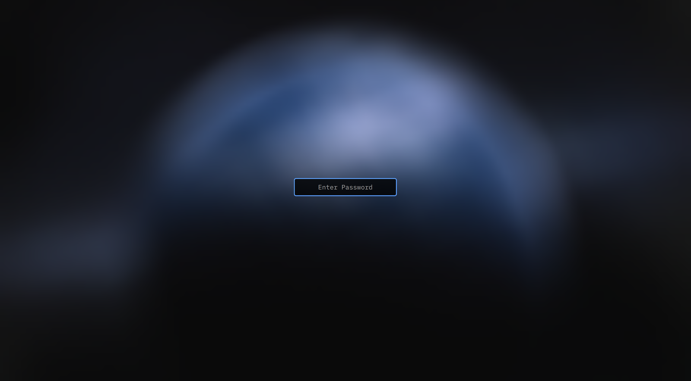

# stormscope

A fast, native NEXRAD weather-radar viewer for Linux — RadarScope-style
workflow, built in Rust with [egui/eframe](https://github.com/emilk/egui) on
Vulkan (wgpu), native Wayland and X11.

**Free public data only**: NOAA/NWS NEXRAD Level II (via Unidata's AWS Open
Data buckets), `api.weather.gov` alerts, SPC convective outlooks, and
OpenStreetMap-derived basemap tiles. No accounts, no API keys, no telemetry.

[](https://github.com/photon01666/stormscope/actions/workflows/ci.yml)
[](LICENSE)
[](https://github.com/photon01666/stormscope/releases)

<!--
Screenshot regeneration: focus stormscope, then
    grim -g "$(hyprctl -j clients | jq -r '.[] | select(.class=="stormscope") | "\(.at[0]),\(.at[1]) \(.size[0])x\(.size[1])"')" /tmp/shot.png
    magick /tmp/shot.png -resize 1600x docs/screenshot.png
-->


## Features

**Radar data**
- Live decoding of NEXRAD Level II message 31 volumes (REF, VEL, SW, ZDR,
  CC, PHI, KDP) — wrap around `nexrad-data`/`nexrad-decode`, no
  reimplementation of the binary format.
- Live mode (Unidata chunk stream, poller + freshness watchdog) and archive
  mode (date picker, per-day volume windows, paging through the whole day).
- Animation ring with a timeline scrubber: play/pause, frame stepping,
  adjustable fps, exact per-frame timestamps.
- Reflectivity filter (min dBZ) both in the controls sidebar and as a
  floating quick-adjust bar on the map — scroll over it to step 5 dB.
- Optional **3D radar pane**: every elevation cut of the current scan as one
  rotatable volume, beside the map or maximized. Drag orbits, right-drag
  (or W/A/S/D over the pane) pans freely, wheel zooms; the bottom-center sliders set the echo floor,
  opacity and height scale; the sidebar adds a tilt range and an altitude
  slab (feet). The ground is the same basemap the 2D map draws, and custom
  markers rise from it as pins. Range rings are 50-mile landmarks, like a
  sectional chart.
- Scan-age badge next to the precip/clear-air mode badge: exact age of the
  newest scan with cadence-aware staleness colours.

**Overlays**
- SPC Day 1–3 categorical outlooks (fills under the radar, outlines on top)
  with the NWS definition of each risk level — legend in the sidebar, hover
  an outline for the brief explanation, and click it for the full SPC
  forecaster discussion.
- NWS warnings (tornado / severe thunderstorm / flash flood) drawn as colored
  polygons, plus an alerts browser: every active alert nationwide on one tab,
  just the selected station's area on the other, with a search filter.
  Hovering a list row — or the polygon on the map itself — glows and labels
  that warning, and a second's rest on a polygon pops a brief description
  under the pointer. Overlapping warnings all light up and are named, reachable
  by their outlines even where one is drawn under the other, and clicking the
  same spot again steps through the stack;
  clicking jumps to it — loading the station that covers it when the alert is
  outside the selected one's range; click a polygon (or the row's Details
  button) for the full NOAA description and safety instruction.
- The top-of-map alerts pill flashes in the issued color (tornado / severe
  thunderstorm / flash flood, watches dimmed) when one of those watches or
  warnings is in force near the selected station — checked every 60 seconds
  with a tiny point query, so a new warning lights up within about a minute.
- NWS gridpoint forecast from the *Forecast* pill next to the alerts badge:
  the selected station's area by default, or any point you click on the map
  ("Pick on map…"), with day/night periods, the full NOAA narrative, current
  station conditions, and a 15-minute auto-refresh while the window is open.
- Storm tracks: cell-motion arrows, dashed 30-minute nowcasts, mph labels.
- Per-marker arrival ETAs ("storm reaches this pin in ~14 min") derived from
  smoothed cell motion; velocity estimates blend scan-to-scan so they
  converge instead of jumping.
- Range rings, radar-site dots + city labels, user markers with persistence.
- Measure tool: drag an A–B line (endpoints snap to your markers, then radar
  sites), draggable blue bubble showing statute miles, tap to expand km +
  bearing.

**UI / platform**
- Auto-hiding controls sidebar that slides in on left-edge hover, with a
  pin; the sidebar, its windows and their tooltips scale on high-resolution
  monitors without fighting the OS scale factor.
- Dark basemap synthesized from the light OSM/Wikimedia tiles (hue-preserving
  inversion), on-disk tile cache, dBZ-filtered look tuned for echoes.
- Native Wayland (no XWayland round-trip) with X11 fallback; Vulkan via wgpu.

## Install

**Prebuilt binary** (Linux x86_64, glibc): grab the asset from the
[latest release](https://github.com/photon01666/stormscope/releases):

```sh
chmod +x stormscope-*-linux-x86_64
./stormscope-*-linux-x86_64
```

**From source** (Rust stable ≥ 1.85 for edition 2024):

```sh
cargo install --path crates/stormscope-app
```

Runtime requirements: Linux with working Vulkan drivers (Mesa/Intel/AMD/NVIDIA)
and a Wayland or X11 session. No other system packages beyond a normal desktop
stack.

## Performance notes

The app is written so a full radar frame never lands on the UI thread and the
expensive raster work happens only when something actually changes:

- Gate geolocation is cached as *zoom-independent* world coordinates and
  reused across pans, zooms, moment switches and playback frames; rotated
  scan layouts are handled by remapping rows instead of rebuilding.
- Drags, playback and wheel-zoom bursts rasterize at half resolution with a
  full-resolution pass when the gesture stops.
- The 3D pane renders on demand: only when its camera, settings, volume,
  ground tiles or size changed. Motion frames draw at half resolution and one
  sharp frame lands 160 ms after the motion stops — idle wakes cost a texture
  sample instead of a volume pass (the policy is a unit-tested pure
  function).
- Splats are premultiplied, division-free, into a persistent buffer uploaded
  through one reused GPU texture.
- Measured on the development machine (Intel Arc A310, 2540×1329 viewport): heavy
  echo-dense motion frames ~10 ms, geometry rebuilds once per scan shape.
- Memory: the animation ring has a resident-memory budget (oldest-first
  eviction, ≥ 8 frames retained), the tile texture cache is bounded, and the
  allocator is tuned to return decode-sized buffers to the OS — an overnight
  session sits near 2 GB instead of creeping.
- Basemap tiles: per-provider circuit breaker (a 403/429 server is skipped
  for a cooldown and the last working provider is preferred) so one blocked
  tile server cannot stall the map.

Run with `RUST_LOG=debug` to see per-raster timings and the 10-second
memory/texture accounting.

## Data sources & attribution

| Source | Used for | Terms |
| --- | --- | --- |
| [Unidata NEXRAD Level II](https://registry.opendata.aws/noaa-nexrad/) (`unidata-nexrad-level2-chunks`, `noaa-nexrad-level2`) | Volume scans, live chunks | NOAA public-domain data |
| [`api.weather.gov`](https://www.weather.gov/documentation/services-web-api) | Active warning polygons | US Government work; a descriptive `User-Agent` is required and sent |
| [SPC](https://www.spc.noaa.gov/) | Day 1–3 categorical outlooks | US Government work |
| [Wikimedia Maps](https://maps.wikimedia.org/) (`osm-intl`), with [OpenStreetMap](https://www.openstreetmap.org/) fallback | Basemap tiles | © OpenStreetMap contributors, ODbL — attribution is drawn on the map |

Tiles are fetched anonymously at low volume and cached on disk; the dark
theme is synthesized locally from the light tiles.

## Architecture

```
crates/
  radar-core/       data model contract: volumes, sweeps, moments, VCP, sites, warnings
  radar-decode/     NEXRAD Level II bytes -> radar_core::Volume (archive + realtime)
  radar-data/       S3 fetch/cache/live poll, NWS alerts, SPC outlooks, site catalog
  radar-render/     projection, color tables, rasterization, tiles, storm tracks
  stormscope-app/   eframe app: state, timeline, panels, wiring
```

Heavy work (fetch, decode, rasterize) runs on background threads and
communicates over channels; the UI polls state each frame. All times are UTC
internally, all coordinates WGS84 degrees.

## Status & roadmap

Single-site radar is solid; the interesting gaps are:

- Multi-site mosaics / composites.
- Storm-relative velocity and other derived products.
- Configurable color tables / palettes.
- Packaging (AUR, Flatpak) and a proper `.desktop` entry.
- Windows/macOS are untested (the crate is wgpu-based, so it should port).

## Contributing

See [CONTRIBUTING.md](CONTRIBUTING.md). Issues and PRs welcome — bug reports
with the app's `RUST_LOG=debug` output are especially useful.

## License

[MIT](LICENSE). Third-party license inventory (all permissive) in
[docs/THIRD-PARTY.md](docs/THIRD-PARTY.md).
